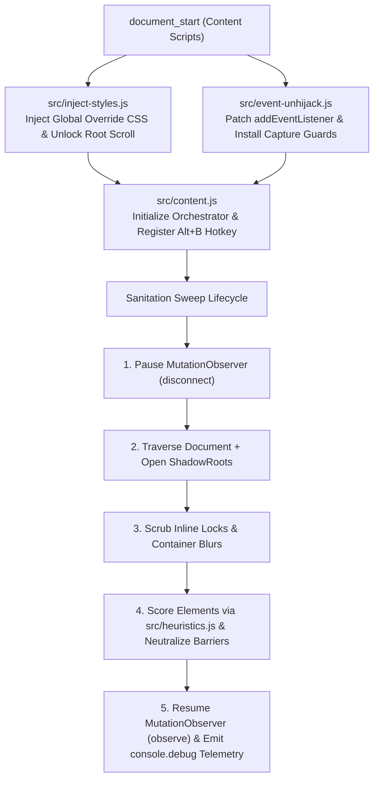

# DOM-Unshackle

**DOM-Unshackle** is a production-grade Chromium Extension (Manifest V3) engineered to systematically neutralize client-side pseudo-paywalls, scroll locks, event hijacking, and CSS blur/backdrop filters using deterministic multi-signal DOM heuristics rather than fragile, hardcoded selector blacklists.

---

## Key Capabilities

1. **Global CSS Invalidation Engine (`src/inject-styles.js`)**
   - Injects a high-priority override stylesheet at `document_start` before page scripts render or lock the viewport.
   - Restores native scrolling on `<html>` and `<body>` (`overflow: auto !important`, `position: static !important`, `max-height: none !important`, `touch-action: auto !important`).
   - Strips `filter: blur(...)`, `backdrop-filter`, `-webkit-backdrop-filter`, and transparent `text-shadow` obfuscation from text containers.
   - Restores text selection (`user-select: auto !important`) and click interactivity (`pointer-events: auto !important`).
   - Scrubs inline `!important` lock declarations directly from `documentElement` and `body`.

2. **Heuristic Overlay & Barrier Detection (`src/heuristics.js`)**
   - Zero reliance on static domain/selector blacklists; evaluates live DOM geometry, stacking contexts, and semantic attributes.
   - Neutralizes detected barriers via inline `!important` suppression rules (`display: none !important`, `visibility: hidden !important`, `pointer-events: none !important`) without detaching nodes from the DOM tree, preventing React/Next.js/Vue hydration and reconciliation crashes (`NotFoundError`).
   - Explicitly protects core structural landmarks (`<article>`, `<main>`, `<nav>`, `<header>`, `<footer>`), interactive forms (`<form>`, `<input>`, `<textarea>`, `<select>`, `<button>`), multimedia (`<video>`, `<audio>`, `<canvas>`, ``), and any ancestor container wrapping `<article>` or `<main>`.

3. **Event De-hijacking & Open Shadow DOM Traversal (`src/event-unhijack.js`)**
   - Intercepts `EventTarget.prototype.addEventListener` and installs preemptive capture-phase guards at `document_start`.
   - Forces `{ passive: true }` and disarms `Event.prototype.preventDefault()` on `wheel`, `touchmove`, and `scroll` listeners attached to `window`, `document`, `<html>`, and `<body>`.
   - Protects keyboard navigation keys (`Space`, `PageDown`, `ArrowDown`, `PageUp`, `ArrowUp`, `Home`, `End`) from capture/cancellation while preserving normal keystroke behavior inside `<input>`, `<textarea>`, `<select>`, and `contenteditable` elements.
   - Recursively traverses nested open `shadowRoot` trees to inject override styles and neutralize barriers encapsulated inside Web Components.

4. **Debounced `MutationObserver` & Emergency Hotkey (`src/content.js`)**
   - Coalesces high-frequency SPA DOM mutations (`120ms` debounce window) to eliminate layout thrashing on complex applications.
   - Enforces strict `disconnect()` / `observe()` cycles around every sanitation sweep (`try / finally`) and ignores self-originating mutations to prevent infinite observer loops.
   - Provides an instant manual sweep hotkey (**`Alt + B`**) and structured `console.debug` telemetry reporting sweep trigger, execution duration (`durationMs`), and count of neutralized barriers.

---

## Architecture & Execution Pipeline



### Project Layout

```text
Unshackle/
├── manifest.json               # Manifest V3 configuration (run_at: document_start, <all_urls>)
├── package.json                # Lint & unit test scripts (Node.js native test runner)
├── README.md                   # Architecture & operational documentation
├── src/
│   ├── inject-styles.js        # Global CSS override layer & inline lock scrubber
│   ├── heuristics.js           # Multi-signal barrier scoring & structural safe-guards
│   ├── event-unhijack.js       # Scroll/key event de-hijacking & Shadow DOM traversal
│   ├── content.js              # Debounced MutationObserver, sweep orchestrator & Alt+B hotkey
│   ├── popup.html              # Extension Popup GUI markup
│   ├── popup.css               # Extension Popup dark-mode stylesheet
│   └── popup.js                # Extension Popup settings, domain toggle & telemetry controller
└── tests/
    ├── inject-styles.test.js   # Unit tests for CSS invalidation engine
    ├── heuristics.test.js      # Unit tests for heuristic scoring & landmark protection
    ├── event-unhijack.test.js  # Unit tests for event un-hijacking & Shadow DOM recursion
    ├── content.test.js         # Unit tests for observer lifecycle, debouncing & hotkey
    └── popup.test.js           # Unit tests for Popup GUI settings & domain whitelist logic
```

---

## Heuristic Scoring Model

Each non-protected DOM element is evaluated by `scoreElement(el, win)` in [`src/heuristics.js`](src/heuristics.js) across four orthogonal signal categories. An element is classified as an obstructive barrier when its composite score meets or exceeds **`BARRIER_SCORE_THRESHOLD = 60`** and it occupies an elevated stacking context (or full-viewport semantic gate):

| Signal Category | Condition Inspected | Score Contribution |
| :--- | :--- | :--- |
| **Viewport Coverage** | Bounding box spans $\ge 90\text{vw}$ and $\ge 90\text{vh}$ | `+35` |
| **Curtain Geometry** | Bounding box spans $\ge 85\text{vw}$ and $\ge 35\text{vh}$ | `+15` |
| **Stacking Position** | Computed `position: fixed` (`+25`) or `position: absolute` (`+20`) | `+20` to `+25` |
| **Stacking Elevation** | Computed `z-index >= 1000` (`+30`) or `100 <= z-index < 1000` (`+15`) | `+15` to `+30` |
| **Primary Semantics** | `id`, `class`, `role`, or `data-*` matches `paywall`, `overlay`, `backdrop`, `barrier`, `gate`, `interstitial`, `regwall`, `hardwall`, `scroll-lock` | `+30` (`+10` per extra keyword, max `+50`) |
| **Modal / ARIA Semantics** | `role="dialog"`, `role="alertdialog"`, `aria-modal="true"`, or secondary modal tokens | `+15` |
| **Visual Backdrop** | Semi-transparent RGBA dimmer, `linear-gradient` fade mask, or active `backdrop-filter` on positioned layer | `+15` |

### Structural Safe-Guards

Before scoring, `isProtectedElement(el)` immediately exempts:
- **Core Landmarks & Content:** `<article>`, `<main>`, `<nav>`, `<header>`, `<footer>`, `<table>`, and elements with `role="main"`, `role="article"`, `role="navigation"`, or `role="search"`.
- **Forms & Interactive Controls:** `<form>`, `<input>`, `<textarea>`, `<select>`, `<button>`, `<label>`, `<fieldset>`.
- **Multimedia & Graphics:** `<video>`, `<audio>`, `<canvas>`, `<svg>`, ``, `<picture>`.
- **Landmark Ancestors:** Any container element that wraps a descendant `<article>`, `<main>`, `<nav>`, `<video>`, `<audio>`, or `<canvas>`, ensuring the root application shell (`#app`, `#__next`, `.layout-wrapper`) is never hidden.

---

## Installation Guide (Chromium Developer Mode)

1. Clone or download this repository to your local machine:
   ```bash
   git clone https://github.com/noackjona-hash/Unshackle.git
   ```
2. Open any Chromium-based browser (Google Chrome, Chromium, Brave, Microsoft Edge) and navigate to:
   ```text
   chrome://extensions
   ```
3. Enable the **Developer mode** toggle in the top-right corner.
4. Click **Load unpacked** in the top-left action bar.
5. Select the root `Unshackle` directory (containing `manifest.json`).
6. Confirm that **DOM-Unshackle** (`v1.0.0`) appears in your extensions list and is enabled.

---

## Usage & Emergency Hotkey

- **Automatic Operation:** DOM-Unshackle runs automatically at `document_start` on all pages, injecting global CSS overrides, disarming scroll-lock event listeners, and running debounced heuristic sweeps as the page hydrates.
- **Emergency Manual Sweep (`Alt + B`):** Press **`Alt + B`** at any time to immediately force a full sanitation sweep across the document and all open Shadow DOM roots.
- **Telemetry Inspection:** Open Chromium DevTools (`F12` -> **Console**), enable the **Verbose** (`debug`) log level filter, and inspect structured `[DOM-Unshackle]` sweep telemetry:
  ```javascript
  // Example console.debug output:
  [DOM-Unshackle] Sanitation sweep completed: {
    trigger: "hotkey",
    durationMs: 1.42,
    neutralizedBarriers: 2,
    unblurredContainers: 1,
    rootsUnlocked: 2,
    shadowRootsScanned: 1
  }
  ```

---

## Verification & Unit Tests

All verification runs purely in Node.js without launching any external browser instances:

```bash
# Static syntax check across all extension modules
npm run lint

# Execute the full unit test suite
npm test
```
